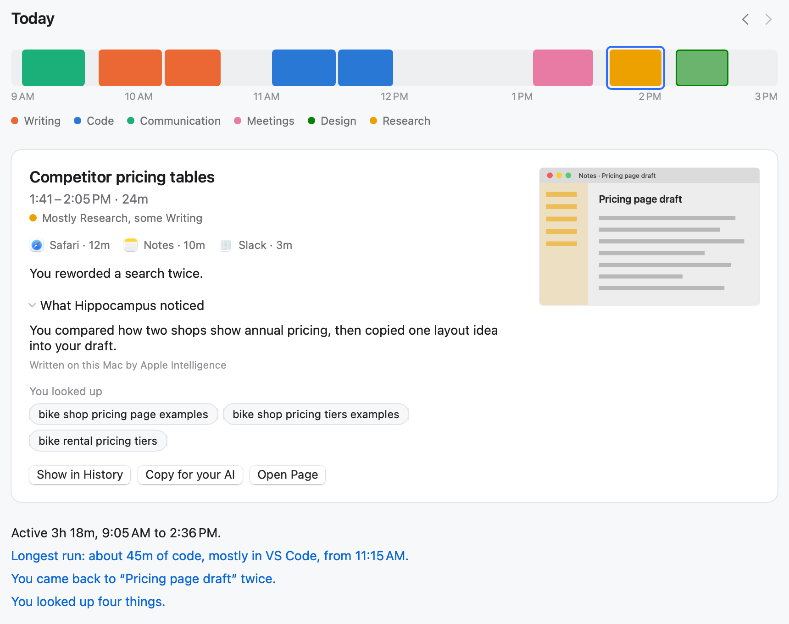

<p align="center"></p>

<h1 align="center">Hippocampus</h1>

<p align="center"><strong>Computers should learn from the way you work.<br>First, they have to remember it.</strong></p>

<p align="center">Hippocampus remembers what’s on your screen, on your Mac only.<br>Your AI already knows what you’re working on.</p>

<p align="center">
  <a href="https://github.com/amyjainberkeley/hippocampus/releases/latest"><strong>Download for Mac</strong></a><br>
  <sub>macOS 14 or later, Apple silicon. Free and open source.</sub>
</p>

<p align="center">
  
  <br><sub>Sample data.</sub>
</p>

## What it does

**Ask.** Press Shift twice and Ask drops from the menu bar over any app. Ask about the window in front of you or something from last week. Matches appear as you type, by meaning and by exact words. Every answer cites its sources, this window first. ⌃⇧Space works too.

**Your day, in Overview.** Your day as sessions you can click, a card for what you’re on right now, and a short summary written on your Mac.

**What it learns about you, in You.** The exact words your AI is given about you, and why Hippocampus thinks so. Mark what’s right. Forget what isn’t.

**Context for your AI.** Connect Claude Code or Codex once, from the menu bar. Each new session starts with your recent work and what Hippocampus has learned about you, with sources. For any chatbot, Copy for your AI puts the same context on your clipboard.

<p align="center">
  
  <br><sub>Overview, with sample data.</sub>
</p>

Answers need Apple Intelligence or a model on your Mac. Hippocampus finds Ollama or LM Studio by itself. Without either, search still works.

## Privacy

<p align="center">
  <picture>
    <source media="(prefers-color-scheme: dark)" srcset="assets/branding/hi-states-dark.svg">
    
  </picture>
</p>

- **You can always tell.** A solid dot means it is remembering. No solid dot means it is not.
- **It stays on your Mac.** Encrypted on disk. Nothing is uploaded by Hippocampus.
- **Some things are never read.** Password fields and password managers. Private browser windows are skipped when they show they are private, and a short list of bank and sign-in sites when their address shows.
- **Your AI sees it only if you connect it.** What a connected tool reads goes to the company that runs it. Connected tools can still read your memory while Hippocampus is quit. Disconnect a tool to stop that.
- **You can stop it.** Pause from the menu bar. Quit, or Stop Sharing in macOS, ends it.
- **Deleting is real.** Delete the last 24 hours or everything, and what was learned from it goes too.

Hippocampus itself has no cloud service. There is no account and no telemetry. If you let it, a connected AI tool starts each session with your recent work and up to six things learned about you. Beyond that, a connected AI client sends only the context it requests to its selected provider.

[PRIVACY.md](PRIVACY.md) says what is stored, where, and every request the app makes. [SECURITY.md](SECURITY.md) says how to report a gap.

## Download

[Download the latest release](https://github.com/amyjainberkeley/hippocampus/releases/latest), open the disk image and drag Hippocampus to Applications. It needs macOS 14 or later on Apple silicon.

Setup is four screens. It asks for two permissions, Screen Recording and Accessibility, and reads nothing until you click Start Remembering.

This is a beta. [docs/STATUS.md](docs/STATUS.md) says what works today and how it was checked.

## Build from source

You need Xcode 26, the Rust toolchain named in [rust-toolchain.toml](rust-toolchain.toml), and Python 3.12 with [uv](https://docs.astral.sh/uv/) for the text reader.

```bash
git clone https://github.com/amyjainberkeley/hippocampus.git && cd hippocampus
./scripts/try-it.sh    # search over a made-up memory, with no permissions
./scripts/check.sh     # the lanes CI runs
```

To build a disposable copy of the app for your own Mac:

```bash
uv venv tools/ocr/.venv --python 3.12
uv pip install --python tools/ocr/.venv/bin/python --require-hashes --no-deps -r tools/ocr/requirements.txt
env -i HOME="$HOME" PATH=/usr/bin:/bin tools/ocr/.venv/bin/python tools/ocr/prepare.py
cargo build -p mci-agent --bins -p hippocampus-native-host
for package in apps/hippocampus adapters/macos/MCICaptureHelper apps/recall-ui apps/onboarding apps/mind; do
  ./scripts/swift-package.sh build --package-path "$package"
done
./apps/hippocampus/Resources/build-app.sh --debug --development-ad-hoc --development-lite
```

A development copy uses the same data folder as an installed one, so build it under a separate macOS user. [scripts/README.md](scripts/README.md) covers signed builds. [ARCHITECTURE.md](ARCHITECTURE.md) is the map, and [CONTRIBUTING.md](CONTRIBUTING.md) says how to send a change.

## Built on research

Research on general user models describes a computer that learns what you’re working on and what you care about from how you use it, and revises what it believes as it sees more. That starts with a faithful memory of your work, kept on your Mac, where you can see what it learns.

Omar Shaikh, Shardul Sapkota, Shan Rizvi, Eric Horvitz, Joon Sung Park, Diyi Yang and Michael S. Bernstein. [Creating General User Models from Computer Use](https://arxiv.org/abs/2505.10831). 2025.

## License

Apache 2.0. See [LICENSE](LICENSE) and [NOTICE](NOTICE).
