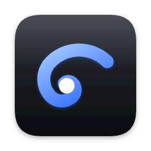
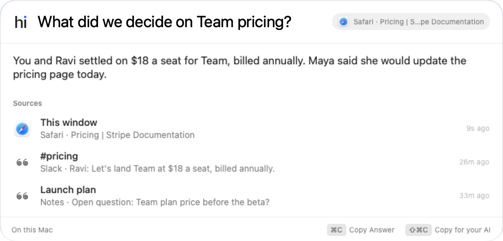

<p align="center"></p>

<h1 align="center">Hippocampus</h1>

<p align="center"><strong>Computers should learn from the way you work.<br>First, they have to remember it.</strong></p>

<p align="center">Hippocampus remembers what’s on your screen and learns how you work, in words you can check.<br>It’s open source, and your memory stays encrypted on your Mac.</p>

<p align="center">
  <a href="https://github.com/amyjainberkeley/hippocampus/releases/latest/download/Hippocampus.dmg"><strong>Download for Mac</strong></a><br>
  <sub>macOS 14 or later, Apple silicon. Free and open source.</sub>
</p>
<!-- SITE_LINK: when the site is live, add its address here, for example: <p align="center"><a href="https://…">Website</a></p> -->

<p align="center">
  
  <br><sub>Sample data.</sub>
</p>

## Install

```bash
curl -fsSL https://github.com/amyjainberkeley/hippocampus/releases/latest/download/install.sh | sh
```

It downloads the latest release, checks its checksum, Apple’s notarization and the developer’s signature, and copies Hippocampus to Applications. It also puts the `mci-agent` command on your PATH. [scripts/install.sh](scripts/install.sh) says every step.

Or with Homebrew:

```bash
brew install --cask amyjainberkeley/tap/hippocampus
```

Or [download the disk image](https://github.com/amyjainberkeley/hippocampus/releases/latest/download/Hippocampus.dmg) and drag Hippocampus to Applications.

Setup is five short screens. It shows what you get first, then asks for two permissions, Screen Recording and Accessibility, and reads nothing until you click Start Remembering.

## What it does

**Ask.** Press Shift twice and Ask drops from the menu bar over any app. Ask about the window in front of you or something from last week. Matches appear as you type, by meaning and by exact words. An answer cites its sources, this window first. ⌃⇧Space works too.

**Overview.** Your day as sessions you can click, a card for what you’re on right now, and a short summary written on your Mac.

**You.** What Hippocampus has learned about you, in the exact words your AI tools are given, with the moments behind each line. Mark what’s right. Forget what isn’t.

**Your AI tools start with what you’re working on.** Connect Claude Code or Codex from the menu bar. They can then search your memory through the `hippocampus` MCP server, with tools such as `mci_recall`, `mci_context` and `mci_user_model`. If you let them, each session starts with your recent work and up to six things learned about you, with sources. For any other chatbot, Copy for your AI copies what you’re working on, for you to paste.

Answers and summaries need Apple Intelligence (macOS 26) or a model on your Mac. Hippocampus finds Ollama or LM Studio by itself. Without either, search still works.

## Privacy

<p align="center">
  <picture>
    <source media="(prefers-color-scheme: dark)" srcset="assets/branding/hi-states-dark.svg">
    
  </picture>
</p>

- **You can tell.** A solid dot means it is remembering. No solid dot means it is not.
- **It stays on your Mac.** Encrypted on disk. Hippocampus itself has no cloud service. There is no account and no telemetry, and it uploads nothing you saw.
- **Some things are skipped.** Password fields, six password managers, private browser windows that show they are private, and a short list of bank and sign-in sites. They are rules, and [PRIVACY.md](PRIVACY.md#what-is-skipped) says what they miss.
- **Your AI tools read it only if you connect them.** What a connected tool reads goes to the company that runs it. A connected tool can read your memory while Hippocampus is quit, until you [disconnect it](PRIVACY.md#disconnecting-an-ai-tool).
- **You can stop it.** Pause from the menu bar. Quit, or Stop Sharing in macOS, stops remembering.
- **Deleting is real.** Delete the last 24 hours or everything, and what was learned from it goes too.

[PRIVACY.md](PRIVACY.md) says what is stored, where, every request the app makes, and its threat model. [SECURITY.md](SECURITY.md) says how to report a gap.

## What it costs

Reading the screen is the cost. The numbers below are measured, each with its source. A full day’s CPU, memory and battery use hasn’t been measured yet; [docs/STATUS.md](docs/STATUS.md) will carry it when it is.

| | Measured | Source |
| --- | --- | --- |
| Reading one window | 3.7 to 4.8 CPU-seconds and about 4 J at the median; 1.3 to 1.7 GB peak memory while reading | [Reader bake-off](eval/ocr-bakeoff-2026-10-15.md), MacBook Air M3, made-up screens |
| Lines read exactly, on the bench’s flat screens | 96.7% (Apple Vision, tuned: 93.9%) | The same bake-off |
| Disk image | 180 MB | The same bake-off, a 0.3.0 candidate with this reader |
| Installed app | 370 MiB, 243 MiB of it the reader | The same bake-off |

How hard it may work is set in code, not measured: the window in front is read at most every 3 seconds, other windows at most every 30, and after each read the reader rests three times as long as the read took. On battery those rests are longer, and in Low Power Mode only the window in front is read ([PRIVACY.md](PRIVACY.md#what-is-stored)).

The reader is PP-OCR, bundled. It reads code and small text more exactly than Apple Vision on the repo’s bench, and costs 8 to 10 times Vision’s CPU per read. To check the numbers yourself, run `tools/ocr/screens/bakeoff.py` with the capture helper’s `OCRQualityProbe`, as the bake-off’s Reproduce section shows.

This is a beta. [docs/STATUS.md](docs/STATUS.md) says what works today and how it was checked.

## Build from source

You need Xcode 26, the Rust toolchain named in [rust-toolchain.toml](rust-toolchain.toml), and Python 3.12 with [uv](https://docs.astral.sh/uv/) for the text reader.

```bash
git clone https://github.com/amyjainberkeley/hippocampus.git && cd hippocampus
./scripts/try-it.sh    # search over a made-up memory, with no permissions
./scripts/check.sh     # every check, as CI runs them
```

To build a disposable copy of the app for your own Mac:

```bash
uv venv tools/ocr/.venv --python 3.12
uv pip install --python tools/ocr/.venv/bin/python --require-hashes --no-deps -r tools/ocr/requirements.txt
env -i HOME="$HOME" PATH=/usr/bin:/bin tools/ocr/.venv/bin/python tools/ocr/prepare.py
cargo build -p mci-agent --bins -p hippocampus-native-host
for package in apps/hippocampus adapters/macos/MCICaptureHelper apps/recall-ui apps/onboarding apps/mind; do
  ./scripts/swift-package.sh build --package-path "$package"
done
./apps/hippocampus/Resources/build-app.sh --debug --development-ad-hoc --development-lite
```

A development copy uses the same data folder as an installed one, so build it under a separate macOS user. [docs/GUIDE.md](docs/GUIDE.md) covers the command line, [scripts/README.md](scripts/README.md) covers signed builds and releases, [ARCHITECTURE.md](ARCHITECTURE.md) is the map, and [CONTRIBUTING.md](CONTRIBUTING.md) says how to send a change.

## Built on research

Hippocampus learns the way a general user model does (Shaikh et al., 2025). It keeps what it learns as a personal context model: plain statements on your Mac, each linked to the moments behind it, in the exact words your AI tools receive. You can read each one, mark it right, or remove it.

Omar Shaikh, Shardul Sapkota, Shan Rizvi, Eric Horvitz, Joon Sung Park, Diyi Yang and Michael S. Bernstein. [Creating General User Models from Computer Use](https://arxiv.org/abs/2505.10831). 2025.

## License

Apache 2.0. See [LICENSE](LICENSE) and [NOTICE](NOTICE).
